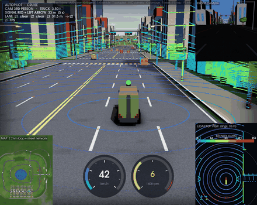
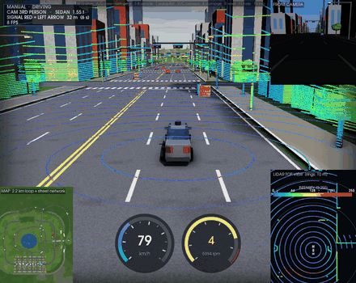
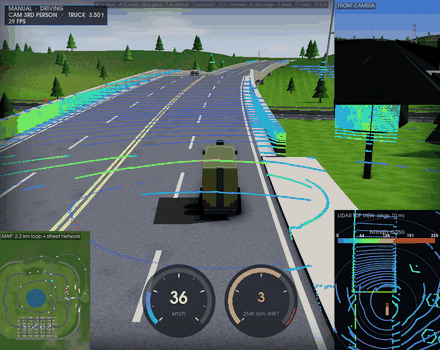
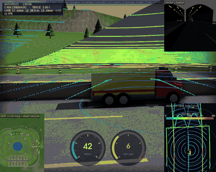
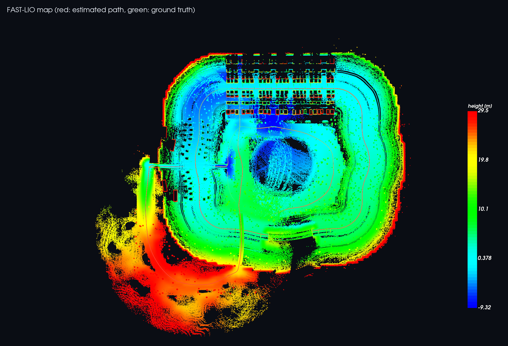
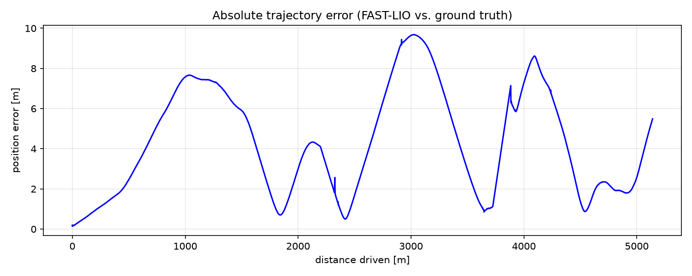

# LiDAR Drive — VTK 자율주행 + 충돌 변형 시뮬레이터

컴퓨터 그래픽스 기말 프로젝트. 수업 예제 `Autocomputergraphics2026/vtk/drive-vehicle`(PID 육면체 메시, 피킹 하이라이트, 전방 카메라)을 분석하고, 같은 구조 위에 도시 · LiDAR · 자율주행 · 충돌 변형을 얹어 확장했다.

| 도심 자율주행 + LiDAR | 충돌 변형 |
|:---:|:---:|
|  |  |
| **고가도로 진입** | **터널 LiDAR 점군** |
|  |  |

## 원본 대비 확장

| 원본 drive-vehicle | LiDAR Drive |
|---|---|
| 45 m 직선 도로, 기둥 10개 | 왕복 6차선 2.2 km 순환 코스(도심 · 숲길 장애물 코스 · 고속도로 · 터널 · 교외) + 고가도로 · 지하차도가 있는 두 번째 도로망 |
| 박스 2개 + 원기둥 바퀴 | 트럭 / 세단 / SUV / 스포츠카 육면체 메시 (원본과 같은 차량 좌표계 · PID 1~4) |
| 차량이 등속 이동 | 키보드 운전(단일 트랙 동역학 · 8단 변속) + LiDAR 기반 자율주행 + 교통 차량 · 신호등 |
| ElementScalar 무지개 색 | 재질 팔레트 LUT + 충돌 후 변형률 컬러맵 |
| 전방 카메라 inset | 전방 카메라 + LiDAR 탑뷰 + 미니맵 + 계기판 HUD |
| — | 32채널 LiDAR, 충돌 변형 · 분석 패널, 그림자 · 텍스처 · 셰이더 효과, 데이터셋 녹화, FAST-LIO SLAM 검증 |

## 그래픽스 구현

- **메시**: 모든 형상은 `VTK_HEXAHEDRON` 셀의 `vtkUnstructuredGrid` (PID 15개, 약 30만 셀). `SceneBuilder::morphedHex`가 매개변수 격자 (u, v, w)를 형상 함수로 사상해 곡면 차체 · 도로 · 건물을 만든다. 셀 데이터 `ElementScalar`(색 번호) → `vtkLookupTable`
- **기하 변환**: 차량 좌표계 → World 를 4×4 행렬 하나로 `M = T · Rz(ψ) · Ry(θ_road) · T(c) · Ry(θ) · Rx(φ) · T(−c)` (무게중심 c 기준 피벗 회전). PID 1~4, 바퀴, 그림자, 1인칭 카메라가 같은 `vtkTransform` 공유
- **카메라**: 3인칭 / 위 / 자유 / 시네마틱 / 1인칭. 직접 구현한 쿼터니언(`src/app/Quaternion.h`)으로 아크볼 회전과 slerp 추적
- **렌더링 구성**: 레이어 3개(장면 / LiDAR 오버레이 — 깊이 버퍼 공유 / HUD) + 뷰포트(전방 카메라, LiDAR 탑뷰, 미니맵). 렌더 패스 SSAO → ACES 톤 매핑 → FXAA
- **조명 · 재질**: 태양(평행광) + 하늘색 보조광 + 헤드라이트, 차체 · 유리 · 호수만 PBR + 하늘 IBL
- **텍스처**: 이미지 파일 없이 value noise / fBm 으로 아스팔트 · 잔디 · 콘크리트 · 구름 하늘 생성, world 좌표 평면 매핑 + 밉맵 · 비등방 필터링
- **그림자**: 움직이는 차는 평면 투영 행렬 × 자세 행렬(찌그러짐도 반영), 건물 · 나무는 투영 삼각형을 그림자 마스크 텍스처에 한 번 래스터화
- **셰이더 치환** (`vtkShaderProperty`): 거리 기반 안개(1/gl_FragCoord.w), 넓은 면의 노이즈 질감
- **피킹**: `vtkCellPicker` → actor → PID → 하이라이트(차량은 와이어프레임, 장면은 외곽선), 충돌 후 클릭한 셀의 변형량 표시

## 기능

### LiDAR + 자율주행
- Velodyne VLP-32C 스펙: 32채널(−25° ~ +15°), 10 Hz, 수평 0.2° → 한 바퀴 57,600 광선, 최대 200 m
- 광선마다 지면(해석적 교차) · 메시(`vtkStaticCellLocator`) · 지형(높이맵 레이 마칭) · 움직이는 차(OBB) 중 가장 가까운 교차점
- 반사 강도 = 재질 반사율 × 입사각 항 + 잡음 (차선 페인트 · 표지판은 재귀반사)
- 스레드 풀에서 렌더링과 병렬로 계산
- 자율주행은 **LiDAR 점만 보고** 판단: 차로별 앞 여유 거리 → 차로 변경 · 추종 · 커브 감속 · 긴급제동, Pure Pursuit 조향. 신호는 V2X로 받음

### 차량 동역학
- 동적 단일 트랙 모델: 슬립각, 타이어 횡력, 하중 이동, ABS / EBD / TCS / ESC
- 엔진 출력 곡선 + 8단 자동 변속(M 키로 수동, Q / E 변속)
- 교통 차량도 충돌하면 같은 모델로 미끄러지고 회전, 바퀴 · 차축 손상

### 충돌 변형 + 분석
- 접촉 순간 운동량 교환(질량 · 반발계수), 차체가 흡수한 에너지로 찌그러짐 깊이 결정
- 충돌면에 가까운 절점일수록 많이 밀어 넣어 육면체 메시를 직접 변형 (크럼플 존 · 주름 · 보닛 솟음)
- 셀마다 변형률(`PlasticStrain`)을 계산해 컬러맵으로 표시 (K)
- 충돌 분석 패널: 파손 등급, 충돌 방향, 충격 에너지, 최대 찌그러짐, 운전석 침범량, 부상 위험

### 월드
- 신호등(교차로마다 다른 주기, 좌회전 화살표), 터널, 고가도로 · 지하차도, 교통 차량
- 지형(산 · 호수), 주택가 · 논밭 · 풍력발전기 등 주변 풍경

### 데이터 취득 (F9)
KITTI / SemanticKITTI 형식으로 녹화: 점군(`.bin`, `.pcd`), 점별 클래스 라벨, 3D 박스, 전방 카메라, 포즈, 캘리브레이션. 저장 위치 `문서\LidarDriveData\`.

## FAST-LIO SLAM 검증

시뮬레이터 LiDAR + IMU 데이터를 ROS bag으로 내보내 FAST-LIO(ROS Noetic, WSL Ubuntu 20.04)로 지도를 만들었다. 도구는 `tools/slam/`.

| 주행 거리 | ATE RMSE | 최종 위치 오차 |
|:---:|:---:|:---:|
| 5.14 km | 5.12 m | 5.49 m (0.107 %) |

 

지도 작성 과정: [docs/slam/fastlio_slam_10s.gif](docs/slam/fastlio_slam_10s.gif)

## 조작

| 키 | 동작 |
|---|---|
| W / ↑, S / ↓ | 가속, 브레이크(정지 시 후진) |
| A / D, ← / → | 조향 |
| Space | 핸드브레이크 |
| T | 자율주행 켜기 / 끄기 |
| 1 / 2 / 3 / 4 | 차종: 트럭 / 세단 / SUV / 스포츠카 |
| M, Q / E | 자동 ↔ 수동 변속, 기어 내림 / 올림 |
| C / V | 카메라 모드 순환 / 1인칭 ↔ 3인칭 |
| 마우스 드래그 · 휠 · 클릭 | 카메라 회전 · 확대 · PID 선택 |
| K | 변형률 색 계속 보기 |
| L / G | LiDAR 점 / 고스트 표시 |
| R | 리셋 |
| F1 / F9 / F12 | 사용 안내 / 데이터 녹화 / 스크린샷 |

## 빌드 · 실행

필요: Visual Studio 2022 Build Tools, Qt 6.10.2 (`msvc2022_64`), VTK 9.6 (Qt 지원으로 빌드)

```bat
build.bat      :: C:\dev\lidar-drive-build 에 LidarDrive.exe, autopilot_sim.exe 생성
run.bat        :: 실행
```

경로에 한글이 있으면 CMake 재생성이 실패하는 경우가 있어 빌드 폴더를 프로젝트 밖에 둔다.

## 구조

```
src/
  core/                 GUI 없는 시뮬레이션 (VTK만 사용)
    SceneBuilder.*      육면체 메시 생성 (morphedHex, ribbon, block …)
    World.*             PID 메시, 코스 배치, 충돌 판정
    RoadModel.*         도로 중심선(직선 · 원호), (s, lat) 좌표
    VehicleShapes.*     차종 4종 메시
    VehicleModel.*      차량 동역학 · 변속기
    LidarSensor.*       멀티스레드 레이캐스팅
    AutoPilot.*         인지 · 판단 · 제어
    CrashDeformer.*     차체 변형 · 변형률
    DriveSim.*          시뮬레이션 루프, 교통, 충돌 처리
    DataRecorder.*      데이터셋 녹화
  app/                  Qt + VTK 렌더링
    MainWindow.*        렌더러 · 카메라 · 입력 · 패널
    PidActorManager.*   원본 예제 클래스 + transform / 변형률 / PBR 확장
  sim_main.cpp          헤드리스 테스트 (autopilot_sim.exe)
tools/                  녹화 프레임 확인, FAST-LIO 실행 스크립트
```

## 테스트

`autopilot_sim.exe`는 창 없이 시뮬레이션을 돌려 확인한다.
- 도로 기하가 닫히는지, 좌표 변환 왕복 오차
- 자율주행 4개 속도로 한 바퀴: 충돌 · 차선 이탈 · 신호 위반 0회
- 차종별 0→100 km/h와 변속, 충돌 변형 · 폐차, 물체 튕김, 도로망 한 바퀴
