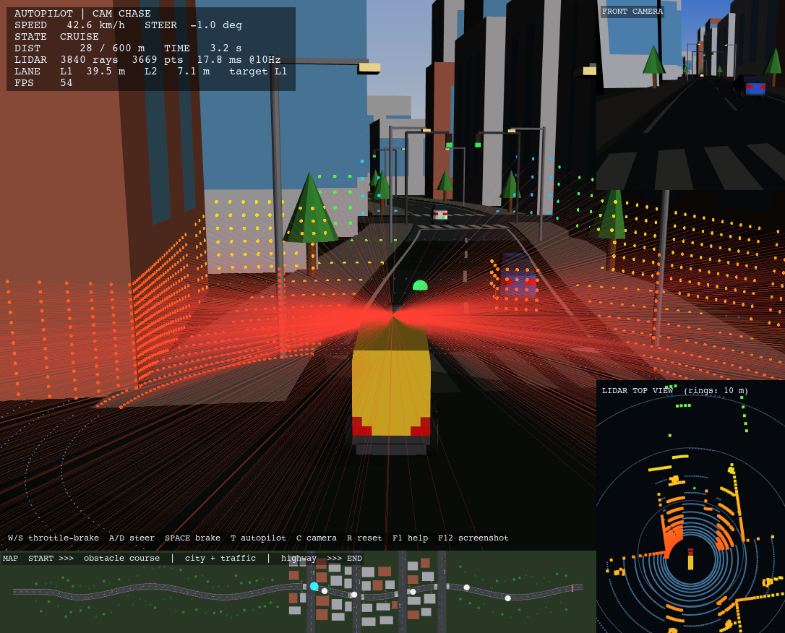
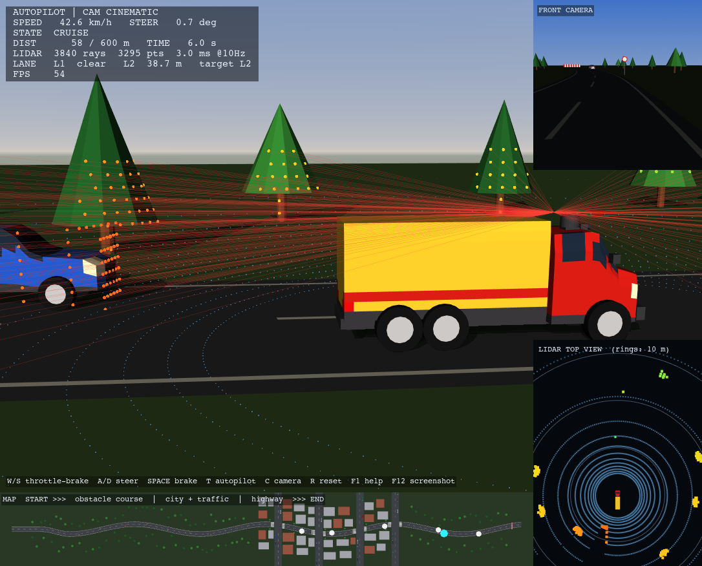
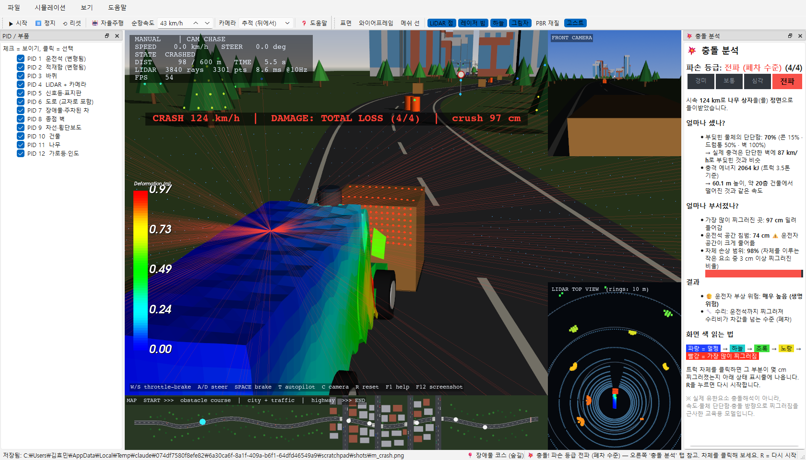
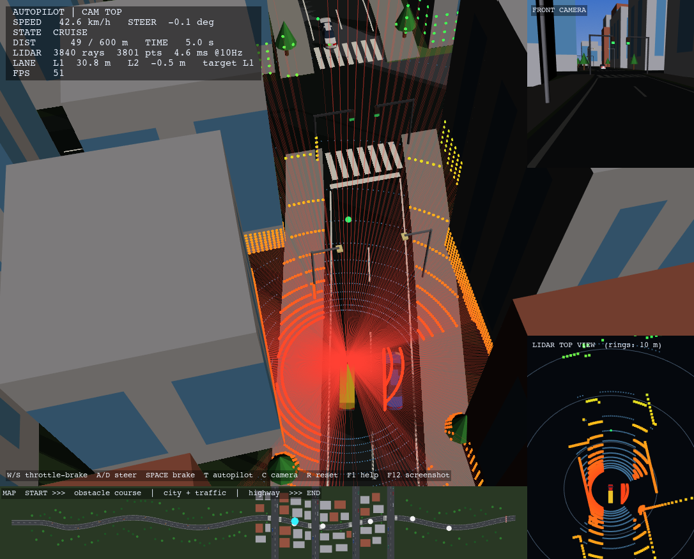

# LiDAR Drive — VTK 자율주행 + 충돌 변형 시뮬레이터

컴퓨터 그래픽스 기말 프로젝트. 수업 예제 `Autocomputergraphics2026/vtk/drive-vehicle`을 분석하고 확장했다.

| 자율주행 + LiDAR (도시) | 트럭 모델 |
|---|---|
|  |  |
| **충돌 변형 + 충돌 분석 패널** | **교차로 (위에서 보기)** |
|  |  |

## 원본 대비 확장

| 원본 drive-vehicle | LiDAR Drive |
|---|---|
| 45 m 직선 도로, 기둥 10개 | **왕복 6차선 2.2 km 순환 코스**: 도심(교차로 6곳, 유리 고층빌딩) → 코너 → S자 숲길 장애물 코스 → 코너 → 휘어지는 고속도로(가드레일·중앙분리대) → 코너 → 교외 주택가 → 도심. 안쪽엔 호수·공원, 바깥엔 산 |
| 박스 2개 + 원기둥 바퀴 | **차종 선택**: 트럭 / 세단 / SUV / 스포츠카 hex 메쉬. 모두 원본과 같은 차량 좌표계(4×1)·PID 1~4라 변형·충돌·LiDAR 공통. 무게·출력·브레이크·센서 높이도 차종별 |
| — | **신호등**: 교차로마다 주기·시작 시점이 다른 한국식 4구 신호(적·황·좌회전 화살표·녹) + 옆길 신호. 다른 차와 자율주행이 지킴, 수동 운전 신호 위반 감지 |
| — | **터널**: 고속도로 S자 구간을 관통하는 190 m 쌍굴 터널 (타일 벽, 아치 천장, 천장 조명, 포탈과 흙 언덕) |
| 차량이 -x로 등속 이동 (10 m/s) | **키보드 운전**(동적 단일 트랙 모델: 슬립각·매직 포뮬러 타이어·하중 이동·마찰원·ABS/EBD/TCS/ESC, 8단 기어비로 구동력 결정, 트럭 0→100 km/h 10.3초; 교통 차량도 충돌 후 단일 트랙 모델로 미끄러짐·회전, 바퀴/차축 손상, X·Space로 드리프트) + **자율주행** + **양방향 교통 20대** (지나간 차는 앞쪽에 재등장) |
| — | **데이터 취득**: KITTI / SemanticKITTI 형식 점군·점별 정답 라벨·3D 박스·카메라·포즈 녹화 |
| 우상단 전방 카메라 inset | 전방 카메라 + **LiDAR 탑뷰** + **전체 미니맵** + HUD |
| ElementScalar 무지개 색 | 재질 팔레트(인덱스 LUT) + 충돌 후 **변형량 컬러맵** |
| — | 충돌 시 **변형 애니메이션 + 일반인용 충돌 분석 리포트** |
| — | 구름 낀 하늘, 지형(산·호수), SSAO, FXAA, 원근 안개, 표면 질감 셰이더, 그림자 마스크, 선택적 PBR(유리·차·호수 반사), 고스트 리플레이, 한국어 사용 안내 |

## 기능

### A. 가상 LiDAR (Velodyne Ultra Puck VLP-32C 스펙) + 자율주행

| 항목 | 값 |
|---|---|
| 채널 | 32, 세로 -25° ~ +15° (실제 VLP-32C 고도각 표, 지평선 근처 0.33° 간격) |
| 회전 / 가로 해상도 | 10 Hz / 0.2° → 한 바퀴 1,800방위 × 32 = 57,600 rays |
| 점 수 | 초당 576,000 |
| 거리 / 정확도 | 200 m / ±3 cm 노이즈 |
| 색 | **반사 강도(intensity)**: 재질 반사율 × 입사각 항 (+노이즈). 차선 페인트·표지판·라이트 = 재귀반사 |

- **회전식 스캔**: 매 시뮬레이션 단계마다 그동안 돈 각도(10 ms = 36°)의 열만 발사. 점 구름은 최근 한 바퀴의 롤링 버퍼
- 정적 물체는 `vtkStaticCellLocator::IntersectWithLine`, 지면은 해석적 교차 + 지면 재질 함수(아스팔트/차선/횡단보도/인도/잔디/물),
  산(지형)은 높이맵 레이 마칭(40 m 타일 최대 높이로 빈 구간 건너뛰기 + 이분법), 움직이는 차는 회전 박스(OBB) slab test
- 바닥 점은 차량 좌표로 저장해서 트럭과 함께 부드럽게 이동, 장애물 점은 월드 좌표에 고정
- 성능 최적화 (측정 기반):
  - LiDAR용 **대리 형상**: 건물·주차 차량은 상자 하나로 (물리 엔진의 collider처럼). 렌더링 메쉬는 그대로
  - 로케이터 분할을 직접 지정 (약 1 m × 1 m × 8 m, 칸 수 1천만 개 이내)
  - 장면 경계 상자로 하늘 방향 레이 조기 종료
  - **영구 스레드 풀**: 단계마다 스레드를 새로 만들던 방식은 초당 수백 번의 생성/종료로 GPU 드라이버를 방해해
    20~30 FPS, 최대 130 ms 끊김 → 스레드 풀로 60~110 FPS, 최대 끊김 15~26 ms
  - 도시 구간 LiDAR 비용: 930 → 236 ms / 시뮬레이션 1초
  - **파이프라인**: GUI에서는 각 단계가 쏠 방위(열)와 그 순간의 차량·교통 상태만 기록하고, 실제 레이캐스팅은
    프레임을 그리는 동안 백그라운드 스레드에서 실행 → 인지는 1프레임 전 데이터 사용(실제 센서 파이프라인과 같은 지연).
    시뮬레이션과 렌더링이 겹쳐서 도심 자율주행 11 → 31~36 FPS
  - 장애물 점의 도로 좌표(s, 횡오프셋)도 LiDAR 작업 스레드에서 계산 → 인지 단계는 읽기만
- AutoPilot은 **LiDAR 점만 보고** 판단 (장애물 위치 정답 데이터 사용 안 함)
  - 인지: 점 → 곡선 도로 좌표(호 길이 s, 횡방향 오프셋) → 내 방향 3차선 각각의 앞쪽 여유 거리 + 옆 차선 점유 여부
    (머리 위 신호등 팔·가로등 헤드·안내판은 높이로 걸러냄)
  - 판단: 가장 빈 차선을 목표로 정하고 한 차선씩 이동(중간 차선이 앞에서 막혀 있어도 통과 가능, 옆에 차가 있으면 대기,
    중앙선은 넘지 않음) / 감속·추종 / **커브 감속**(곡률 κ → v = √(a_lat/κ), 앞 90 m를 보고 미리 감속) /
    **AEB 긴급제동** / 정지
  - 제어: 도로를 따라 앞쪽 목표점(s + Ld)으로 Pure Pursuit 조향 + P 속도 제어

### B. 충돌 변형 + 충돌 분석
- 차체(PID 1·2)는 hex 요소 약 5,000~5,500개의 solid mesh. 박스 격자를 차 모양 함수로 변형(morph)해서 만듦
- 찌그러짐 깊이는 **충돌 에너지**로: ½mv² = ½kx² → x = v·√(m/k) (k ≈ 1 MN/m @ 1.5 t, 시속 56 km 정면에서 약 0.6 m)
- crush zone 모델: 범퍼는 깊이만큼, 방화벽 쪽으로 갈수록 덜 밀리는 **압축**(크럼플 존) + 충돌 방향으로 접히는
  **아코디언 좌굴** + 바깥으로 **부풂**(포아송) + **보닛 텐트** + 부드러운 찌그러짐 노이즈. 기둥·나무는 U자로 감싸며 파고듦
- **충돌이 쌓이는 손상 모델** (`DriveSim::resolveImpact`): 닿는 즉시 끝내지 않는다. 첫 접촉 시점(이분 탐색)에서
  충돌 법선 방향 **운동량 교환** J = −(1+e)·μ·v_n (μ = m₁m₂/(m₁+m₂), 반발계수 e는 물체별) + 접선 마찰,
  중심에서 벗어난 충격은 **회전**(요 관성 m(L²+W²)/12)과 **옆미끄러짐**으로. 소산 에너지 ½μv_n²(1−e²) 중
  물체별 몫(벽 100%, 차 50%, 가드레일 60%)을 차체가 흡수 → 그 위치에 찌그러짐 추가
- 물체별 질량: 콘 4 kg · 드럼통 80 kg · 나무 상자 180 kg(**튕겨 날아가 굴러 쓰러짐**, 메쉬 점을 직접 강체 변환) ·
  교통 차량 1450 kg(밀려나고 잠시 정지) · 벽/건물/나무/교각/주차된 차는 고정
- **손상률** = 흡수 에너지 누적 ÷ (48 km/h 정면 벽 충돌 에너지). **100%** 또는 운전석 침범 35 cm 이상이면 폐차 → 주행 종료
- 이미 찌그러진 곳은 더 단단함: 누적 찌그러짐 x = √(x₀² + 2E/k). 찌그러진 만큼 충돌 외곽선(footprint)도 줄어듦
- 실시간 변형: 목표 형상으로 0.1초 만에 접근, 7% 동적 과변형 → 탄성 복원. 옆 충돌은 접촉 위치의 문·적재함을 찌그러뜨림
- 셀별 `Deformation`(평균 변위 m)과 **`PlasticStrain`**(육면체 모서리 길이 변화의 RMS, %) cell array →
  충돌해석 후처리기(LS-PrePost)처럼 **12단계 띠 컬러맵**으로 변형률 등고선 표시
- 충격 표현: 충돌 펄스(최대 감속 g = v²/x, 지속 시간 π/2·x/v)로 **카메라 흔들림**, 유리·도장·플라스틱 **파편**(중력·튕김·마찰)
- **충돌 분석 패널** (비전문가용):
  파손 등급 4단계(경미/보통/심각/전파), 무엇과 어느 방향으로 충돌했는지, 체감 충격(벽 기준 속도), 최대 g·충돌 시간·최대 변형률,
  충격 에너지와 "몇 층 높이에서 떨어진 것과 같은지", 최대 찌그러짐, **운전석 공간 침범량**,
  손상 범위 %, 운전자 부상 위험, 수리 수준
- 충돌 후 차체를 클릭하면 그 요소의 변형량이 상태바에 표시됨
- HUD `DAMAGE` 막대, 충돌마다 `IMPACT` 배너·흔들림·파편, 변형률 색은 충돌 직후 4초 (K: 계속)

### C. 그래픽 연출
- 절차적 하늘: 높이별 그라디언트 + fBm 노이즈 구름(하늘 위 평면에 투영해서 천정에서 늘어나지 않음) + 태양 글로우 → `vtkSkybox`
- **지형**: 도로에서 멀어질수록 높아지는 산(fBm 노이즈 높이맵, 경사·높이에 따라 풀/마른 풀/숲 바닥/바위 색),
  코스 안쪽은 완만한 공원 + **호수**(PBR 반사)
- **SSAO** (`vtkSSAOPass`): 건물 밑동, 차 밑, 구석에 자연스러운 그늘. SSAO 합성 단계가 깊이를 다시 써서
  LiDAR 점 오버레이 렌더러(깊이 공유)도 그대로 동작
- **FXAA**: 계단 현상 제거
- **셰이더 주입** (`vtkShaderProperty` 치환, `MainWindow::setAtmosphere`): VTK가 만든 셰이더에 코드를 끼워 넣음
  - 원근 안개: 거리 d = 1/gl_FragCoord.w, 색 → 하늘 연무색, 1 − e^(−d/1100)
  - 표면 질감: 물체 좌표의 다중 옥타브 value noise로 색을 ±몇 % 변조 (평평한 아스팔트·잔디·벽이 덜 CG같이)
  - 약한 S커브 대비 + 채도 보정
- **그림자**: 움직이는 차는 평면 투영 행렬(Blinn 1988) × 자세 행렬. 정적 물체(건물·나무·기둥…)는
  투영한 삼각형을 시작할 때 한 번 **그림자 마스크 텍스처(0.5 m 해상도)**에 래스터화해서 지면에 깔음 →
  반투명 메쉬가 겹치는 곳마다 두 번 어두워지던 문제(빌딩 숲 도로가 새까매짐) 해결, 건물을 두 번 그리던 비용도 제거
- 조명: 따뜻한 태양(방향광) + 반대편 하늘색 보조광 + 약한 헤드라이트
- **선택적 PBR**: 유리 빌딩(금속성 0.85, 거칠기 0.08)·차량 도장·트럭·호수만 PBR + IBL(어둡게 만든 하늘 사본).
  전부 PBR로 하면 렌더 47 ms → 반사가 의미 있는 곳만 PBR로 해서 13~24 ms
- 고스트 리플레이, 카메라 5종(3인칭/위/자유/시네마틱/1인칭), 충돌 시 자동 오빗 카메라

### C-2. 쿼터니언 아크볼 카메라 (`src/app/Quaternion.h`)
- 쿼터니언을 직접 구현했다: 해밀턴 곱, 켤레(역회전), 벡터 회전 `q v q*`, 두 벡터 사이 최단 회전(`fromTo`), **Slerp**
- **Shoemake 아크볼**: 마우스 두 점을 가상 구 위로 올려 그 사이 회전을 쿼터니언으로 계산.
  장면을 `drag`만큼 돌리는 것은 카메라를 `drag⁻¹`만큼 돌리는 것과 같다
- 카메라 방향 = `frame × userRot`
  - 추적/위/시네마틱: `frame`이 트럭 진행 방향(z축 회전)을 따라감 → 주행 중에도 돌려 놓은 시점 유지
  - 자유: `frame` 고정 → 트럭이 돌아도 보는 방향 유지
  - 사용자 회전을 프레임 기준으로 바꾸는 식: `userRot' = frame⁻¹ · Δ · frame · userRot`
- 마우스를 놓고 2초 뒤 `slerp(userRot, identity, k)`로 원래 시점으로 부드럽게 복귀 (토글 가능)
- **1인칭(운전석)**: 운전자 눈 위치(좌측 핸들)에 카메라를 차체에 고정, 같은 쿼터니언으로 고개 돌리기, 휠 = 시야각(FOV).
  대시보드·계기판·A필러·룸미러와 조향각 × 조향비 14로 실제로 돌아가는 운전대를 추가.
  차체 벽은 바깥쪽을 향한 면이라 **backface culling**을 켜면 운전석 안에서 창밖이 보이고 보닛·사이드미러는 그대로 보임
- 휠 = 확대/축소, 더블클릭 또는 Home = 원위치, 클릭(드래그 없이) = PID 피킹
- 헤드리스 테스트에 쿼터니언 단위 테스트 포함 (회전, 합성, fromTo, slerp, 역원)

### E. 도로 / 교통 (`RoadModel.*`, `World.cpp`, `DriveSim.cpp`)
- **순환 도로**를 직선·원호 조각으로 정의하고 호 길이 s로 매개변수화: `point(s, lat)`, `heading(s)`, `curvature(s)`.
  코너 4개(R 110 m, 90°)와 S자 시케인(+θ, −2θ, +θ: 방향과 횡위치가 원래대로 돌아옴)을 조합해서 정확히 닫힘(오차 1e-9 m)
- `project(x, y) → (s, lat)`: 1 m 간격 중심선 샘플 + 8 m 격자 인덱스로 가까운 샘플을 찾고, 현(chord) 투영 후
  곡률을 고려한 뉴턴 보정 2회 (오차 < 0.1 mm). 지면 재질, LiDAR 인지, 교통, 충돌 판정이 모두 이 좌표계를 사용
- 왕복 6차선, 우측통행: 진행 방향 오른쪽 3차선이 내 방향, 노란 이중 중앙선 건너편 3차선이 반대 방향
- 도로 표시·LiDAR 지면 재질 함수가 같은 규칙(중앙선, 점선, 가장자리선, 횡단보도 20줄, 방향별 정지선)을 공유해서
  반사 강도 점군에 차선이 그대로 나타남
- 가드레일(고속도로 양쪽, 코너 바깥쪽)과 콘크리트 중앙분리대는 횡오프셋으로 충돌 판정
- 교통: 같은 방향 11대 + 마주 오는 차 9대. 차간거리 유지, 코너 감속, 플레이어 차에도 반응.
  멀어진 차는 플레이어 앞 빈 자리에 재배치 (같은 방향 차는 장애물 코스 구간에 들어가지 않음)
- 출발 위치 선택: 도심 / 장애물 코스 / 고속도로 / 교외 주택가 (툴바 **출발**)
- **8단 자동변속기** (`VehicleModel`): 엔진 출력 곡선 P(n) = Pmax(x + x² − x³), x = n / n_peak (토크 최대 = 최고출력 rpm의 절반),
  기어비 4.71 / 3.14 / 2.11 / 1.67 / 1.29 / 1.00 / 0.84 / 0.67, 종감속비는 8단·최고속도에서 최고출력 rpm이 되도록 자동 계산,
  토크 컨버터(스톨 회전수까지 슬립, 최대 2배 토크), 풀 스로틀은 출력이 가장 큰 단 선택 / 부분 스로틀은 페달에 따라 변속점 이동(킥다운),
  구동력 = 토크 × 기어비 × 종감속비 / 바퀴 반지름 (가속 한계 클램프 없음, 타이어 마찰원이 한계), 변속 중 0.22 s 토크 컷, 레드존 리미터, 엔진 브레이크. 수동(M) 모드는 Q/E. `autopilot_sim --accel`로 0→100과 변속점 출력
- **도심 뒷길**: 큰길 양쪽 78 m에 평행한 왕복 2차선 뒷길. 옆길이 모두 T자로 만나 블록이 닫힘(막다른 길 없음). 건물 4줄, 뒷길 가로등
- **도로망** (`RoadModel::ring2`, `World::buildRingProfile / buildRingGeometry`): 1.96 km 왕복 6차선 두 번째 루프.
  도심 첫 옆길의 연장(연결 도로)과 T자 교차로로 만나고, 큰 순환도로와는 평면 교차 없이 두 번 지나간다:
  고속도로 위 **고가도로**(데크 7.6 m, 교각·캡·난간, LiDAR 메쉬 포함)와 교외 도로 아래 **지하차도**(옹벽, 교외 도로가 덮개, 덮개 아래 조명).
  높이 프로파일: 중심선 지형을 ±60 m 평활 → 고정점(고가 7.6 m, 지하 −6.8 m, 교차로 0 m)에서 **경사 6.5%** 포락선 → 이웃 경사 제한 → Catmull-Rom 보간.
  지형은 도로를 따라 절토·성토로 블렌딩, 지하차도 구간은 지형 격자를 빼고 고해상도 "스커트"로 메움.
  차는 도로 **높이(z)와 경사(pitch)**를 따라감(`VehicleModel::setElevation`), 겹치는 곳은 현재 높이에 가까운 노면 선택.
  충돌은 노면별(고가 위에선 지상 물체·고속도로 가드레일 무시), LiDAR는 지하차도 구멍(지면 평면 없음)·고가 데크(지면 분류) 처리.
  1 m 래스터 마스크로 LiDAR 조회 O(1). 도로망 교통 8대(70 km/h). 자율주행은 큰 순환도로 전용
- **교통 속도**: 구간 제한속도(도심·교외 50, 숲·코너 60, 고속도로 100 km/h) × 운전자별 0.85~1.12
- **주변 풍경**: 교외 2열 주택·주유소·아파트 단지, 루프 안쪽 논·밭·비닐하우스(지형에 깔린 hex 띠), 호수의 요트·잔교·정자,
  능선 위 풍력발전기(높은 곳 상위 10곳, 150 m 간격), 고속도로 바깥 송전탑(격자 다리 + 처진 전선), 코너 광고판.
  구조물이 땅을 예약하고 나무는 그 자리를 피해서 심음
- **신호등** (`World::signalAt`): 교차로마다 주기 34~46 s, 시작 시점도 달라 따로 바뀜.
  직진 녹 → 황(3 s) → 적 + 좌회전 화살표(6 s) → 전체 적(1 s) → 옆길 녹 → 옆길 황(3 s) → 전체 적(1 s).
  램프는 한 polydata의 셀 색(조명 없이)을 매 프레임 바꿔 표시. 교통 차량은 적색에 정지선 1 m 앞 정지,
  황색은 `d > v²/(2·3.5)`일 때만 정지(딜레마 구간). 자율주행은 V2X처럼 신호를 받아 `v = √(2·2.8·(d−1))`로 감속
  (상태 `RED LIGHT`). 수동 운전으로 적색에 정지선을 넘으면 위반 횟수 + 배너
- **터널** (`World::buildTunnel`): 고속도로 s = +120 ~ +310 m. 방향마다 굴 하나(중앙 벽), 벽 높이 4.8 m + 아치 6.7 m,
  타일 벽에 초록 띠(재귀반사 → LiDAR intensity에서 빨갛게 보임), 천장 조명 줄(조명 없이 밝게), 포탈 벽과 진입부 옹벽,
  위를 덮는 흙 언덕(지형 메쉬에 합침). 벽은 가드레일과 같은 횡오프셋 판정(충돌 물체 "터널 벽"),
  터널 안은 그림자 마스크로 어둡게, 카메라는 천장 아래로 제한. LiDAR는 벽·천장·언덕을 모두 측정

### F. 데이터 취득 (`src/core/DataRecorder.*`)
F9 또는 툴바 **⏺ 데이터 녹화**. LiDAR 한 바퀴(10 Hz)마다 1프레임, 저장 위치 `문서\LidarDriveData\run_날짜_시간\`.

| 파일 | 형식 |
|---|---|
| `velodyne/000000.bin` | KITTI: float32 x, y, z, intensity(0..1). LiDAR 좌표계 x 앞, y 왼쪽, z 위 |
| `labels/000000.label` | SemanticKITTI: 점마다 uint32 = 클래스 \| (차량 ID << 16) |
| `pcd/000000.pcd` | PCD v0.7 binary (x y z intensity ring label) — CloudCompare / PCL / Open3D |
| `boxes/000000.txt` | 3D 박스 정답 (80 m 이내 차·주차차·드럼통·콘·상자): `type id x y z l w h yaw 점개수` |
| `image_2/000000.png` | 전방 카메라 |
| `poses.txt` | KITTI odometry: 프레임마다 LiDAR의 월드 자세 3×4 |
| `frames.csv` | 시간, 위치, 속도, 조향, 가속/브레이크 입력, 자율주행 상태, 차선, 점·박스 개수 |
| `events.csv` | 충돌(물체, 속도, 파손 등급), 리셋 |
| `calib.txt`, `meta.json` | KITTI식 P2 / Tr_velo_to_cam, 센서 스펙(고도각 표 포함), 장착 위치, 클래스 표 |

- 점별 클래스 13종: road, lane_marking, sidewalk, terrain, building, vegetation, pole, traffic_sign, car, obstacle, barrier, water.
  레이캐스트가 맞힌 셀의 재질(Palette)과 맞힌 차량 ID에서 바로 나오므로 **정답 라벨이 자동으로 정확**
- 점은 측정 순간의 센서 자세 기준(회전하는 동안 차가 움직인 왜곡 포함) → 실제 회전식 LiDAR 원시 데이터와 같은 성질
- 시뮬레이션 스레드는 데이터를 복사만 하고 파일 쓰기는 백그라운드 스레드. 디스크가 밀리면 프레임을 건너뛰고 개수를 HUD에 표시
- 헤드리스 대량 생성: `autopilot_sim.exe --record <폴더> [초=60] [출발 0 도심/1 숲/2 고속도로/3 교외] [순항 m/s=12]` (카메라 제외)
- 확인용 스크립트: `python tools/view_frame.py <폴더> [프레임]` → 클래스별 색 BEV + 3D 박스 + 카메라 이미지 PNG

### D. 사용성
- 오른쪽 **사용 안내 패널(F1)**: 조작법, 화면 구성, 코스, 각 기능 설명 (한국어)
- 모든 툴바 버튼에 한국어 이름과 툴팁
- 상태바에 현재 구간과 자율주행이 지금 무엇을 하는지 한국어로 표시
- 왼쪽 아래 미니맵에 순환 코스 전체(호수·지형 포함), 내 위치, 다른 차 표시

## 조작

| 키 | 동작 |
|---|---|
| W / ↑ | 가속 (0→100 km/h: 트럭 10.3 s, 세단 6.5 s, SUV 6.6 s, 스포츠카 4.7 s) |
| Q / E | 기어 내림 / 올림 (수동 변속 M 모드로) |
| M | 자동(D) ↔ 수동(M) 변속 |
| Esc | PID 선택 해제 |
| S / ↓ | 브레이크 (정지 상태면 후진) |
| A / D, ← / → | 조향 |
| Space | 브레이크 |
| T | 자율주행 ON/OFF (큰 순환도로에서만) |
| 1 / 2 / 3 / 4 | 차종: 트럭 / 세단 / SUV / 스포츠카 (메뉴 **🚗 차종 바꾸기**와 같음) |
| K | 손상(변형률) 색 계속 보기 ↔ 충돌 직후 4초만 |
| V | **1인칭(운전석) ↔ 3인칭 전환** |
| C | 카메라 모드 순환 (3인칭 / 위 / 자유 / 시네마틱 / 1인칭) |
| 마우스 드래그 / 휠 | 카메라 회전 (쿼터니언 아크볼) / 확대·축소 |
| 더블클릭, Home | 시점 원위치 |
| L / G | LiDAR 점 / 고스트 표시 |
| R | 리셋 (이번 주행은 고스트로 저장) |
| Enter | 시작 / 정지 |
| F1 | 사용 안내 |
| F9 | **데이터 녹화 시작 / 정지** |
| F12 | 스크린샷 (사진 폴더에 저장) |

데모 / 스크린샷 자동 촬영용 명령행 옵션:
```bat
LidarDrive.exe --autopilot --start 1 --camera 1 --shot 5:a.png --quit 6   :: 장애물 코스에서 시작 (0 도심, 2 고속도로, 3 교외)
LidarDrive.exe --no-hq --no-pbr                                            :: 저사양 모드
LidarDrive.exe --vehicle 3 --start 2 --autopilot                           :: 스포츠카로 고속도로(터널)부터
LidarDrive.exe --start 3 --zoom 12 --orbit -60,20 --shot 4:wide.png --quit 5  :: 멀리서 넓게 (풍경 스크린샷)
LidarDrive.exe --start 4 --throttle --shot 9:viaduct.png --quit 10           :: 도로망 고가도로 (5: 지하차도)
LidarDrive.exe --autopilot --record --quit 30                                   :: 30초 데이터 녹화
LidarDrive.exe --throttle --shot 9:crash.png --shot 9.1:crash_win.png          :: _win.png = 창 전체
```

## 구조

```
src/
  core/                 GUI 없는 시뮬레이션 (VTK만 사용)
    RoadModel.*         순환 도로(직선·원호, 호 길이 s), 투영, 왕복 6차선
    Palette.h           재질 색 팔레트 (셀마다 인덱스 저장)
    SceneBuilder.*      morph hex / box / cylinder / cone / road / ribbon 메쉬 생성
    VehicleShapes.*     플레이어 차종 4종(변형 가능, 스펙 표) + 교통용 세단 메쉬
    World.*             PID 메쉬, 코스 배치, 충돌 판정
    VehicleModel.*      자전거 모델, 로컬↔월드 좌표 변환
    LidarSensor.*       멀티스레드 레이캐스팅, 포인트 클라우드
    AutoPilot.*         인지-판단-제어
    CrashDeformer.*     차체 변형 + 변형량 스칼라 + 통계
    DriveSim.*          시뮬레이션 루프, 양방향 교통, 충돌 리포트
    DataRecorder.*      데이터셋 녹화 (KITTI / SemanticKITTI / PCD, 백그라운드 쓰기)
  app/                  Qt + VTK 렌더링
    MainWindow.*        렌더러 6개, 카메라, 입력, 안내/분석 패널
    PidActorManager.*   원본 예제 클래스 + transform/damage/PBR/LUT 확장
  sim_main.cpp          헤드리스 테스트 + 데이터셋 생성 (autopilot_sim.exe)
tools/
  view_frame.py         녹화 프레임 확인 (numpy + matplotlib)
```

렌더 윈도우 레이어 구성 (렌더러 6개):
- layer 0: 메인 장면 (skybox, 차량, 도로, 건물, 그림자)
- layer 1: 3D 오버레이 (포인트 클라우드, 빔, 목표점). 메인과 카메라·깊이 버퍼를 공유
- layer 2: HUD, 전방 카메라, LiDAR 탑뷰, 미니맵

## 빌드

필요: VS 2022 Build Tools, Qt 6.10.2 (msvc2022_64), VTK 9.6.0 (Qt 지원으로 빌드)

```bat
build.bat      :: C:\dev\lidar-drive-build 에 LidarDrive.exe, autopilot_sim.exe 생성
run.bat        :: 실행
```

빌드 폴더를 프로젝트 밖(`C:\dev\...`)에 두는 이유: 경로에 한글이 있는 폴더 안에서 CMake가
재생성(regenerate)할 때 크래시가 났다.

### 한국어 Windows에서 VTK 빌드 시 주의
VTK configure 중 `malloc.h` 검사가 `LNK1104`(생성된 테스트 exe를 열 수 없음, 백신 실시간 검사 추정)로
실패하면 `HAVE_MALLOC_H`가 비어 netcdf의 `putget.c`가 컴파일되지 않는다.
`CMakeCache.txt`에서 `HAVE_MALLOC_H:INTERNAL=1`로 고치고, `vtk-build\ThirdParty\netcdf\vtknetcdf\config.h`에
`#define HAVE_MALLOC_H 1`을 넣은 뒤 다시 빌드하면 된다.

## 테스트

`autopilot_sim.exe`는 창 없이 시뮬레이션을 실행한다.
- 도로 기하: 순환 도로가 닫히는지, `project(point(s, lat)) == (s, lat)`인지
- 자율주행으로 순항속도 29 / 43 / 58 / 79 km/h에서 2.2 km 한 바퀴 완주 (충돌 없음, 도심 교통 추월, 코너 감속, 장애물 코스 차선 변경)
- 자율주행 한 바퀴 동안 **충돌 0회** (빨라진 교통 포함)
- 수동 풀 스로틀로 직진: 앞차를 밀며 충돌이 쌓이다가 손상률 100%에서 폐차되어야 함 (차종 4종)
- 콘·드럼통을 치면 튕겨 날아가 쓰러지고 차는 계속 달려야 함
- 도로망 한 바퀴(차선 추종): 노면 이탈 0, 충돌 0, 고가(z > 7 m)·지하차도(z < −6 m)·덮개 구간 통과
- 신호: 자율주행 한 바퀴 동안 **신호 위반 0회**여야 통과 (빨간불 대기 포함)
- 세단 / SUV / 스포츠카로도 한 바퀴 완주 + 충돌 변형
- 변속기: 차종마다 풀 스로틀 0→100 km/h, 1→8단을 모두 쓰는지, 정지하면 1단으로 돌아오는지
- `--bench`: 구간별 LiDAR 비용, `--record`: 데이터셋 생성, `--lap v [차종]`: 한 바퀴만, `--road`: 도로 기하만, `--accel`: 가속·변속점, `--crash`: 충돌·튕김·폐차, `--ring [m/s]`: 도로망 한 바퀴
